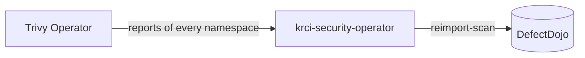

# KubeRocketCI Security Operator

[](https://opensource.org/licenses/Apache-2.0)

One operator for the security integrations of a KubeRocketCI cluster. The first integration imports the Trivy Operator reports of every namespace into DefectDojo.



- **One product per cluster and namespace.** Every namespace has its own DefectDojo product, `<clusterName>/<namespace>`, under one Product Type (`KubeRocketCI` by default), with one engagement, `trivy-operator`. The operator reads no KubeRocketCI resource or label, so it also works on a cluster without KubeRocketCI.
- **One test per container.** Each container of a workload has one DefectDojo test per report kind, `<ReportKind> <kind>/<name>/<container>`, so a redeploy updates the same test. Only changed reports are uploaded.
- **Closes what is gone.** The findings of removed workloads and of deleted or excluded namespaces are closed. The operator closes only the tests of its own cluster.
- **Read-only in the cluster.** Apart from its leader-election Lease and events, it writes only to DefectDojo. No CRDs, no webhooks.

## Prerequisites

- Trivy Operator 0.34 or later.
- DefectDojo 3.5.200 or later. Earlier versions may work but are not tested. See [supported versions](docs/development.md#upstream-sources).
- A DefectDojo API token in a Secret. The token options and the recommended least-privilege setup: [DefectDojo API token](docs/trivy.md#defectdojo-api-token).
- A cluster name, unique per DefectDojo.

## Install

```bash
kubectl create namespace krci-security
kubectl create secret generic defectdojo-credentials -n krci-security \
  --from-literal=url=https://defectdojo.example.com \
  --from-literal=token=<api-token>

helm repo add epamedp https://epam.github.io/edp-helm-charts/stable
helm install krci-security-operator epamedp/krci-security-operator -n krci-security \
  --set clusterName=<cluster-name>
```

Chart values: [deploy-templates/README.md](deploy-templates/README.md). Naming, closing, errors, sizing and access in detail: [docs/trivy.md](docs/trivy.md).

## Limitations

- Two clusters with the same `clusterName` in one DefectDojo write into, and close, the same products.
- A report CRD installed after the operator started is imported on each resync (30 minutes by default) until a restart makes the operator watch it.
- Metrics are off by default; `metrics.enabled=true` serves them over plain HTTP on port 8080 of the pod. Without them, count the Error log entries `DefectDojo rejected a report version` instead of `krci_security_operator_rejected_reports_total` (see [docs/trivy.md](docs/trivy.md)).

## Develop

See [docs/development.md](docs/development.md) and [CONTRIBUTING.md](CONTRIBUTING.md). `make test` runs the unit tests and, with helm installed, the chart render tests; `make lint` runs the linter and `make build` produces `dist/manager-<arch>`.

## Security

See the [Security Policy](SECURITY.md).

## License

This project is licensed under the Apache License 2.0, see the [LICENSE](LICENSE.txt) file for details.
