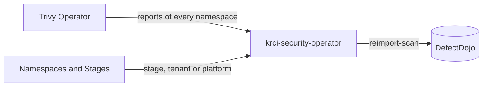

# KubeRocketCI Security Operator

[](https://opensource.org/licenses/Apache-2.0)

One operator for the security integrations of a KubeRocketCI cluster. The first integration imports the Trivy Operator reports of every namespace into DefectDojo.



- **Every namespace in one of three scopes.** A namespace that a KubeRocketCI `Stage` deploys to is a stage, one with the `app.edp.epam.com/tenant` label is a tenant, and everything else, such as Argo CD, Tekton or monitoring, is the platform. Each scope can be switched off.
- **One test per container.** Each container of a workload has one DefectDojo test per report kind, so a redeploy updates the same test. Only changed reports are uploaded.
- **Closes what is gone.** The findings of removed workloads and of deleted or excluded namespaces are closed. The operator closes only the tests of its own cluster.
- **Read-only in the cluster.** Apart from its leader-election Lease and events, it writes only to DefectDojo. No CRDs, no webhooks.

| Scope | DefectDojo product | Engagement |
|---|---|---|
| stage | the codebase of the image, else `env:<cdPipeline>-<stage>` | `runtime:<cdPipeline>-<stage>` |
| tenant | `tenant:<tenant>` | `namespace:<ns>` |
| platform | `platform` | `namespace:<ns>` |

## Prerequisites

Trivy Operator and a DefectDojo API token; tested with Trivy Operator 0.35 and DefectDojo 2.55. The stage scope needs the KubeRocketCI `Stage` resource; without it every namespace is a tenant or the platform.

## Install

```bash
kubectl create namespace krci-security
kubectl create secret generic defectdojo-credentials -n krci-security \
  --from-literal=url=https://defectdojo.example.com \
  --from-literal=token=<api-token>

helm repo add epamedp https://epam.github.io/edp-helm-charts/stable
helm install krci-security-operator epamedp/krci-security-operator -n krci-security \
  --set clusterName=<cluster-name>
```

Chart values: [deploy-templates/README.md](deploy-templates/README.md). Classification, naming, closing, errors, sizing and access in detail: [docs/trivy.md](docs/trivy.md).

## Limitations

- One DefectDojo per cluster: two clusters that write into one DefectDojo overwrite each other's tests of the same names.
- A report CRD installed after the operator started is imported on each resync (30 minutes by default) until a restart makes the operator watch it.
- The chart serves no metrics.

## Develop

See [docs/development.md](docs/development.md) and [CONTRIBUTING.md](CONTRIBUTING.md). `make test` runs the unit tests, `make lint` the linter, and `make build` produces `dist/manager-<arch>`.

## Security

See the [Security Policy](SECURITY.md).

## License

This project is licensed under the Apache License 2.0, see the [LICENSE](LICENSE.txt) file for details.
